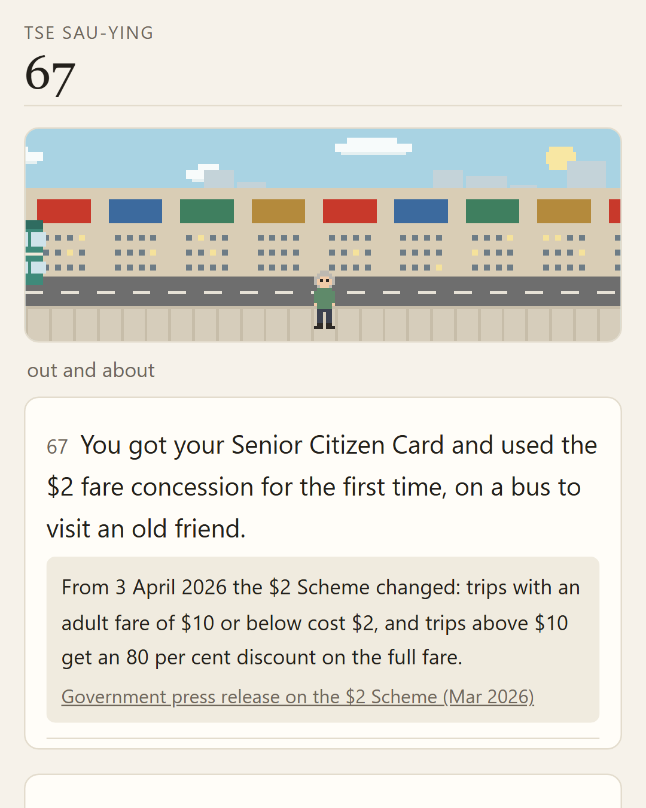

# One Hong Kong Life

A life simulation built on Hong Kong public statistics. The first scenario is **Turning 65 in Hong Kong**: you are dealt one person's 65th birthday in the real census proportions, and you live the years that follow, one at a time, at published odds. It is bilingual, in Traditional Chinese (the default) and English.



Every number a reader sees sits in a shaded box with a link to its source. How those numbers are strung into a life is this project's own model, and the method page says so.

## How it works

- **A generic engine and scenario files.** `engine.js` knows nothing about Hong Kong or ageing. It holds a life's state, rolls each year's events, applies choices, and keeps the record. `scenarios/turn65.js` holds everything topic-specific: the starting draw, the events with their probabilities, the text in both languages, the sources, the life table and the method page.
- **Everything runs in the browser.** There is no server, no build step, no framework, no third-party script and no web font. `index.html` loads five plain scripts. The pixel scenes (`scenes.js`) and charts (`charts.js`) are drawn in code.
- **One life, drawn honestly.** Sex, household, housing type, work, birthplace and ethnic group come from the 2021 census in real proportions. Each year, the chance of dying comes from the 2023 Hong Kong life table. Dementia, cataract, high blood pressure, diabetes, heart disease, stroke, cancer, hospital stays, falls, widowhood and long-term care follow published rates. Three people born on the same day live alongside you by the same statistics.

```
index.html          page shell, styles, light and dark themes
engine.js           the life engine (scenario-agnostic)
scenarios/turn65.js the first scenario: data, events, text, sources, method
app.js              screens and controls
scenes.js           procedural pixel scenes
charts.js           bar lists and the survival curve
tools/simulate.js   headless runner: calibration, experience stats, transcripts
tools/lint.js       checks every line fits its life (no partner after widowhood, and so on)
```

To run it locally, open `index.html` in a browser, or serve the folder with any static server.

## Calibration

The model is checked against the published figures it is built from. The tolerances were fixed before any tuning. To reproduce the table:

```bash
node tools/simulate.js calibrate 20000
```

| Check | Simulated | Target range |
|---|---|---|
| Average age at death, men | 85.63 | 85.07 to 86.07 |
| Average age at death, women | 89.50 | 89.23 to 90.23 |
| Widowed, women 65–74 / 75–84 / 85+ | 24.4% / 43.1% / 70.7% | ±6 points of the 2021 census |
| Widowed, men 65–74 / 75–84 / 85+ | 5.6% / 11.6% / 31.8% | ±6 points of the 2021 census |
| Need long-term care, 85+ | 67.9% | 50% to 70% |
| Dementia, 65–69 to 85+ | 1.7% to 31.5% | ±2 points per age band |
| Cataract ever diagnosed, 65–74 / 75–84 / 85+ | 17.6% / 34.6% / 44.9% | ±6 points of the Population Health Survey 2020-22 |
| High blood pressure, 65–74 / 75–84 | 43.4% / 57.4% | ±6 points of the same survey (45.2% / 59.7%) |
| Diabetes, 65–74 / 75–84 | 15.8% / 21.8% | ±4 points (17.1% / 23.5%) |
| Coronary heart disease, 65–74 / 75–84 | 3.3% / 5.0% | ±2 points (3.9% / 5.7%) |
| Stroke, 65–74 / 75–84 | 1.6% / 4.5% | ±2 points (1.3% / 4.8%) |
| Cancer, 65–74 / 75–84 | 5.3% / 7.4% | ±2.5 points (5.3% / 8.0%) |
| Admitted to hospital in a year, 65+ living at home | 16.3% | ±2.5 points of 16.1% (2025) |

The method page runs the same check on 3,000 lives in the reader's own browser.

## Checking the facts

Before each release, every figure was checked against the text of its source. The checks cover four things:

- every fact box names a source;
- every number in a fact box appears in the text of a cited source, or is listed with how it was derived;
- the Chinese and English versions of each fact carry the same numbers;
- every help-line number appears in its provider's own page.

The checker needs saved copies of the source publications. Those copies are not in this repository, because several publishers' terms do not allow them to be passed on. Every source is linked from the method page instead.

## Checking that lives hold together

Everyday moments carry no figures, so they are checked for logic instead. `node tools/lint.js` plays thousands of lives and fails on any line that does not fit the life it appears in: a partner after widowhood, a grandchild before there is one, an outing during long-term care, a Chinese festival in a non-Chinese life.

## Adding a scenario

A scenario is one script that sets `window.SCENARIO` to an object with:

- `title` and `version`;
- `sources`;
- `draw(rng)`, which creates the starting person;
- `events`, each with `when(s)`, a probability `p(s)` and `run(s, rng)` returning text, an optional fact with sources, and an optional choice;
- `focuses`, `mortality(s)`, `pauses` and `method`.

`scenarios/turn65.js` is the worked example. To check a new scenario headlessly:

```bash
SCENARIO=scenarios/yours.js node tools/simulate.js calibrate
```

## Link options

- `?lang=en` or `?lang=zh` opens in that language.
- `?seed=1234` replays one life exactly in the app, with the game making every choice, within one content `version`. (`tools/simulate.js` numbers its lives its own way, so its seeds are not the app's.)
- `?capture` hides the controls for clean screenshots. `?capture=70` opens straight on the year lived at 70.

Nothing a reader types is ever put in a link or sent anywhere.

## Privacy

There are no cookies, no ads and no personal data. Reflections a reader types stay in their browser. A language preference and a few display settings are kept in local storage. At launch the page may count, as two plain totals, how many lives are started and finished. If it does, the method page says so.

## Credits

The figures come from published Hong Kong sources, which are listed and linked on the method page and in the `SOURCES` object in `scenarios/turn65.js`. The piece restates them in its own words; it does not reproduce the publications.

Copyright in the original publications belongs to the Government of the Hong Kong Special Administrative Region, except that Legislative Council papers are copyright of the Legislative Council. Sources include:

- the Census and Statistics Department (C&SD, www.censtatd.gov.hk);
- the Department of Health, including the Centre for Health Protection and the Elderly Health Service;
- the Social Welfare Department and the Labour Department;
- the Legislative Council (www.legco.gov.hk) and Government press releases (www.info.gov.hk);
- the Mandatory Provident Fund Schemes Authority, cited here on a non-profit basis;
- the Elderly Commission.

Some figures are modified by this project: interpolated between published age bands, fitted, or combined into yearly chances. Those figures are this project's own, they are marked as estimates on the method page, and they are not published C&SD statistics.

**No endorsement.** This is an independent personal project, not affiliated with any organisation. It was not produced, endorsed or sponsored by the Government of the HKSAR, the Legislative Council or any body named above. It uses no logos or emblems. Figures may be out of date or simplified, so check the original publication where it matters.

**Inspiration.** The idea and the shape of this piece come from [1 in 8 Billion](https://1in8b.life), where you become one of the babies being born somewhere in the world right now, at real birth odds, and live that life year by year. This piece borrows its way of working: one life dealt at real odds, lived a year at a time, a sourced figure under each moment, companions born the same day, pauses to reflect, and a card at the end. It is unaffiliated with that site and its operator, and shares none of its code, text or artwork.

**How it was made.** It was built with Claude Code (Anthropic). I decided what goes in and checked the figures against their sources. Using the tool does not imply endorsement by Anthropic.

Made by [Paulo Chak](https://www.linkedin.com/in/paulo-chak/).

## Licence

The code is released under the MIT Licence (see `LICENSE`). The scenario text and the method page are released under CC BY 4.0.

Third-party figures, source titles and the life-table values keep their owners' terms. `NOTICE.md` explains exactly what the licences do and do not cover.
